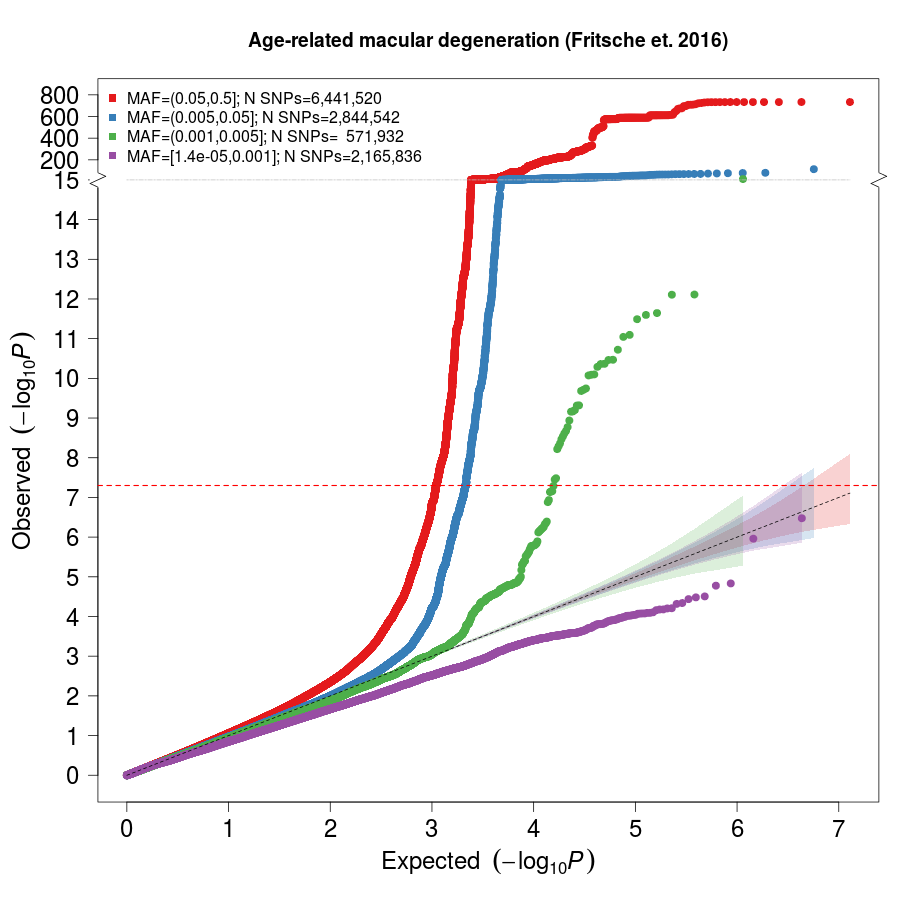
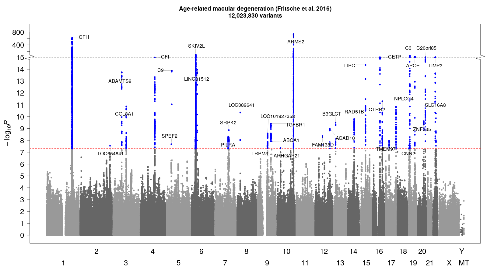
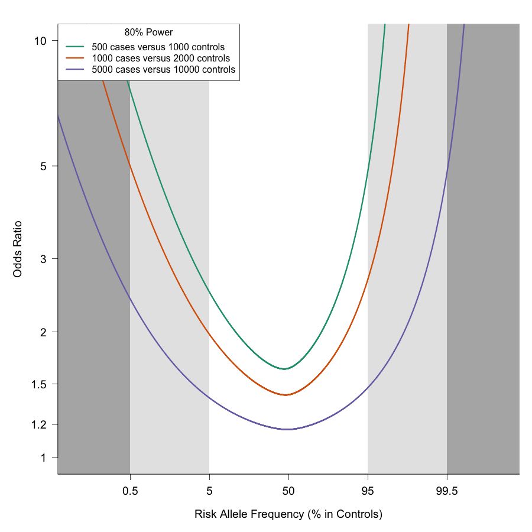

# gwasTools

[](https://github.com/ilarsf/gwasTools/actions/workflows/smoke-tests.yml)

Standalone R scripts for common GWAS plotting tasks:

| Script | Purpose | Main output |
| --- | --- | --- |
| `QQplot.r` | Frequency-binned QQ plot from allele frequency and p-value columns. | `<prefix>_QQ.png` |
| `ManhattanPlot.r` | Manhattan plot with adaptive thinning, candidate-region detection, and optional nearest-gene peak labels. | `<prefix>_Manhattan.png` |
| `PowerPlot.r` | 80% power curves for binary case-control or quantitative traits. | `<prefix>_PowerAnalysis.png` |

Run each script with `--help` for the full option reference:

```sh
Rscript QQplot.r --help
Rscript ManhattanPlot.r --help
Rscript PowerPlot.r --help
```

## Installation

Install R and the runtime packages:

```r
install.packages(c(
  "optparse",
  "data.table",
  "RColorBrewer",
  "plotrix",
  "pwr"
))
```

`Map2NCBI` and `basicPlotteR` are optional. They are needed only for Manhattan nearest-gene labels with `--labelPeaks T`. `basicPlotteR` is installed from GitHub:

```r
install.packages("remotes")
remotes::install_github("JosephCrispell/basicPlotteR")
```

Nearest-gene reference files are not downloaded by default. If labeling is enabled, `ManhattanPlot.r` looks for `data/gene_positions/ExonList_<build>.txt` beside `ManhattanPlot.r`, or for the file supplied with `--gene_table`. The `data/gene_positions/` cache is ignored by git and is created only when `--allow_gene_download T` is used.

## Quick Start

Run these commands from the repository root. They use the synthetic fixtures in `tests/fixtures/` and write outputs to the ignored `tmp/` directory:

```sh
mkdir -p tmp/examples

Rscript QQplot.r \
  --input tests/fixtures/minimal_gwas.tsv \
  --prefix tmp/examples/minimal \
  --maf MAF \
  --pvalue PVALUE \
  --maintitle "Example QQ plot"

Rscript ManhattanPlot.r \
  --input tests/fixtures/minimal_gwas.tsv \
  --prefix tmp/examples/minimal \
  --pos POS \
  --pvalue PVALUE \
  --disable_thinning T \
  --maintitle "Example Manhattan plot"

Rscript PowerPlot.r \
  --prefix tmp/examples/power \
  --cases 500,1000,5000 \
  --controls 1000,2000,10000 \
  --minMAF 0.001 \
  --alpha 5E-8

Rscript PowerPlot.r \
  --trait_type quantitative \
  --prefix tmp/examples/quantitative_power \
  --samples 1000,5000,10000 \
  --minMAF 0.001 \
  --alpha 5E-8
```

## Input Requirements

QQ and Manhattan plots expect tab-delimited summary-statistic files. The default column names are:

| Column | Used by | Meaning |
| --- | --- | --- |
| `CHROM` | Manhattan | Chromosome label. |
| `POS` | Manhattan | Base-pair position. |
| `MAF` | QQ | Minor allele frequency or effect allele frequency. |
| `PVALUE` | QQ, Manhattan | Raw p-value by default. |

Example:

| CHROM | POS | MAF | PVALUE |
| --- | --- | --- | --- |
| 1 | 1 | 0.05 | 0.99 |
| 2 | 2 | 0.15 | 0.1 |
| 3 | 3 | 0.5 | 0.25 |

Use `--chr`, `--pos`, `--maf`, and `--pvalue` when your input uses different column names.

Raw p-values must satisfy `0 < P <= 1`. If the input column already contains `-log10(P)`, pass `--log10p T`; those values must be finite and non-negative.

QQ plots require an allele-frequency column. By default, `--allele_frequency_type auto` folds values greater than 0.5 to minor allele frequency with a warning. Use `--allele_frequency_type MAF` to reject values greater than 0.5.

Manhattan plots require chromosome, position, and p-value columns. The default chromosome column is `CHROM`; legacy files with `CHR` are accepted when `CHROM` is absent. Supported chromosome labels are `1`-`22`, `X`, `Y`, `XY`, `MT`, and equivalent `chr`-prefixed or numeric encodings.

## Manhattan Notes

`ManhattanPlot.r` uses adaptive thinning by default for large GWAS files. Significant variants are retained while less-informative background points are reduced.

Useful thinning options:

- `--thinning_mode`: `adaptive` (default), `random`, or `none`.
- `--disable_thinning T`: Plot all variants.
- `--thinning_aggressiveness`: Retention control for background points. Lower values make a lighter plot; higher values keep more visible density.
- `--thinning_sig_threshold`: `-log10(P)` threshold for variants that should always be kept.

Practical `--thinning_aggressiveness` values:

| Value | Use when | Expected effect |
| --- | --- | --- |
| `0.25` | Fast preview of a very large GWAS. | Strong thinning; fewest background points. |
| `0.5` | Dense datasets where the first plot is overplotted. | More aggressive thinning than default. |
| `1.0` | General use. | Default balance of speed, readability, and density. |
| `1.5` | Final review when the default looks too sparse. | Keeps more background points. |
| `2.0` | Smaller datasets or high-resolution figures. | Densest thinned plot; slower and more crowded. |

In adaptive mode, the retained percentage is data-dependent and is printed when the script runs. Variants at or above `--thinning_sig_threshold` are retained. In random mode, `--thinning_aggressiveness 1.0` samples about 10% of variants before adding always-retained significant variants; `0.5` is about 5%, and `2.0` is about 20%.

When significant hits are present, candidate regions are written to:

```text
<prefix>_ManhattanPlot_<flankingsize-kb>kb_CandidateRegions.txt
```

Nearest-gene labels are opt-in:

```sh
Rscript ManhattanPlot.r \
  --input results.tsv \
  --prefix tmp/examples/with_labels \
  --pos POS \
  --pvalue PVALUE \
  --labelPeaks T \
  --gene_table data/gene_positions/ExonList_hg19.txt
```

Downloads for missing gene tables occur only when `--allow_gene_download T` is provided.

## Power Notes

`PowerPlot.r` keeps binary case-control power as the default. Binary curves plot the odds ratio needed for 80% power against risk allele frequency in controls, or overall risk allele frequency when `--raf.controls F` is used.

For quantitative traits, use `--trait_type quantitative` and provide total sample sizes with `--samples`. Quantitative curves plot the absolute per-allele beta needed for 80% power against effect allele frequency. By default, beta is shown in phenotype standard deviation units. Use `--trait_sd` to scale beta to raw trait units, and `--covariates` to account for model covariates in the denominator degrees of freedom.

## Example Outputs







## Development Validation

The repository includes lightweight smoke tests using synthetic, non-sensitive fixtures:

```sh
scripts/smoke_tests.sh
```

The smoke tests run each `Rscript --help` command, generate QQ, Manhattan, and power plots in a temporary directory, and check adversarial cases such as invalid p-values, mixed chromosome encodings, unsupported contigs, and offline nearest-gene labeling behavior.
